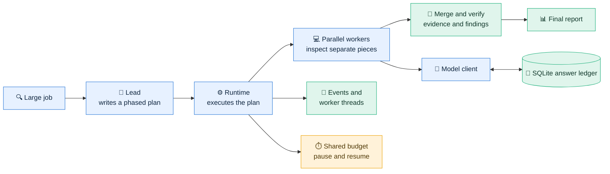
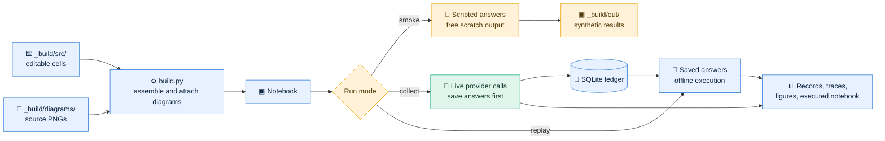
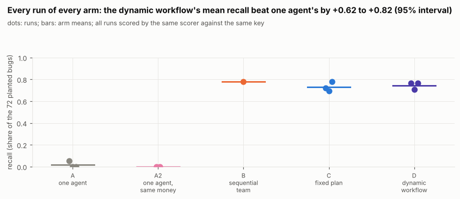
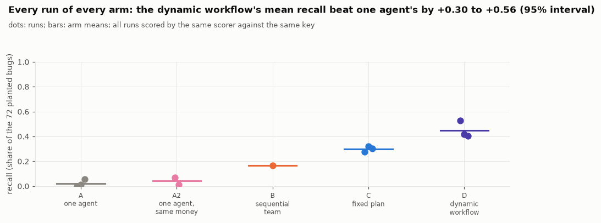

<h1 align="center">⚙️ Dynamic Workflow Agents</h1>

<p align="center"><strong>Build a multi-agent runtime from scratch. Give it a real job. Measure what it actually improves.</strong></p>

<p align="center">
  <a href="#explore-the-notebooks">Explore the notebooks</a> ·
  <a href="#how-the-system-works">How it works</a> ·
  <a href="#what-the-runs-found">Results</a> ·
  <a href="#get-started">Get started</a> ·
  <a href="#repository-guide">Repository guide</a>
</p>

---

This repository contains two self-contained editions of **Dynamic Workflows from Scratch**. In each notebook, a lead agent writes a phased plan, a plain-Python runtime executes it with parallel workers, and experiments test where that design helps. The main job is a planted-bug audit of a large algorithm library. The same engine later grades maths homework and groups customer messages.

| 🔍 Benchmark | 🧪 Experiment | ⚙️ Runtime | 📊 Deliverable |
| :---: | :---: | :---: | :---: |
| **72 planted bugs** | Solo, fixed, and lead-written plans | Parallel phases, events, threads, budgets, and resume | **2 executed notebooks** with outputs and figures |

> [!IMPORTANT]
> The Claude edition completed a live run, offline replay, and prose audit. The Qwen edition completed a live run and passes its notebook checks, but its final offline replay and line-by-line prose audit are still pending. Qwen figures below come from saved live experiment records; treat their interpretation as provisional. Smoke-run numbers are scripted and are never evidence of model performance.

## Explore the notebooks

| | 🔷 Claude edition | 🔶 Qwen edition |
| --- | --- | --- |
| **Open the notebook** | [Read `claude/dynamic_workflows.ipynb`](claude/dynamic_workflows.ipynb) | [Read `qwen/dynamic_workflows.ipynb`](qwen/dynamic_workflows.ipynb) |
| **Provider in the recorded run** | Anthropic API | ModelScope's Qwen endpoint |
| **Accounting** | Per token, in cents | Per call, in Magicubes |
| **Notebook spending cap** | 2,500 cents | 1,500 Magicubes |
| **Recorded answer ledger** | 2,022 calls | 2,617 calls |
| **Validation status** | Live run ✓ · replay ✓ · prose audit ✓ · checks ✓ | Live run ✓ · replay pending · prose audit pending · checks ✓ |

Each edition owns its `pyproject.toml`, lockfile, data, answer ledger, run traces, and generated results. Open and run one edition from its own directory. The notebook chooses its project root by finding the nearest `pyproject.toml`, so that boundary matters.

## How the system works

The lead proposes the work; the runtime controls its execution. A worker can inspect code, use the notebook's tools, and return evidence. The runtime keeps a separate thread for each worker, emits events, applies a shared budget, and combines the phase results into a report.



The notebook teaches the pieces in sequence: create a verifiable benchmark, implement the model client and ledger, establish single-agent baselines, build the runtime, let a lead write plans, then compare those plans with fixed workflows. Its later sections examine failure cases, other jobs, scoring, memory, and operating costs.

### Three ways to execute



**Why keep the ledger?** Every model call is keyed by its request and saved before the answer is used. A matching replay can execute without paying again. The event and thread records also preserve the original run's timing and behavior; replay speed is not a substitute for that timing evidence.

## What the runs found

The code-audit benchmark scores each reported location against a hidden 72-bug answer key. **Recall** is the share of planted bugs found. The table shows the mean of three runs per arm, taken from the [Claude](claude/artifacts/exp_main.json) and [Qwen](qwen/artifacts/exp_main.json) experiment records.

| Audit design | 🔷 Claude recall | 🔶 Qwen recall | What the design does |
| --- | ---: | ---: | --- |
| **One agent** | **1.9%** | **2.3%** | One agent explores the repository alone. |
| **Fixed workflow** | **73.2%** | **30.1%** | A prewritten parallel scan and review plan. |
| **Dynamic workflow** | **74.5%** | **44.9%** | The lead writes a fresh phased plan for the job. |

| Claude runs | Qwen runs |
| :---: | :---: |
| [](claude/artifacts/figures/s52_recall.png) | [](qwen/artifacts/figures/s52_recall.png) |

**The workflow beats solo exploration in this task.** Both dynamic arms found far more of the planted bugs than one agent. That comparison has a real limitation: the solo agents chose to stop early, before reading most of the library. The experiment shows what happened under these prompts and stopping behavior, not what an agent forced to inspect every file would achieve. The saved [solo run records](claude/artifacts/exp_solo.json) show 21 to 46 turns in Claude; the [Qwen records](qwen/artifacts/exp_solo.json) show 96 to 131, against a 150-turn limit.

**A lead-written plan is not automatically better than a fixed plan.** Claude's dynamic mean exceeded its fixed-plan mean by about 1.4 percentage points; the recorded interval for the difference includes zero. Qwen's dynamic mean exceeded its fixed-plan mean by about 14.8 points, with a recorded difference interval of +5.6 to +25.5 points. Precision moved differently: Claude's dynamic and fixed plans scored **63.9%** and **62.3%**, while Qwen's scored **70.7%** and **82.2%**. The Qwen recall gain therefore came with more false positives among its reported locations.

**The later jobs show both value and failure.** On 600 maths solutions, the workflow scored **96.5%** accuracy versus **85.2%** for one long Claude grader, and **96.0%** versus **93.7%** in Qwen. Claude's first-pass grader reached **97.8%**, however, so its added second look reduced the final accuracy. On 10,003 customer messages, the Claude workflow collapsed the data into **2 topics** with adjusted Rand index **0.023** against the reference labels; Qwen produced **30 topics** with index **0.380**. These are separate edition outcomes, not a controlled provider ranking. See the [Claude homework](claude/artifacts/exp_hw_run.json), [Qwen homework](qwen/artifacts/exp_hw_run.json), [Claude messages](claude/artifacts/exp_intents.json), and [Qwen messages](qwen/artifacts/exp_intents.json) records.

### Read the numbers with their limits

- The editions do **not** use identical audited corpora after the notebook's eligibility checks: Claude kept **856 files / 98,028 lines** and Qwen **849 files / 97,269 lines**. Their model families, request behavior, and billing units also differ. Compare the designs **within** an edition before comparing editions.
- The main multi-run arms have only three runs each. Their intervals are wide. A sequential-team arm has one run and is shown in the notebook, but is omitted from the three-run table above.
- The benchmark uses one algorithm collection with planted faults. Its result is evidence about this audit setup, not a general software-engineering score.
- The [pre-registered claim tables](claude/artifacts/exp_claims.json) contain supported **and** unsupported hypotheses. For example, the evidence-based skeptic and pipeline-speed claims did not meet their stated rules in either edition. Qwen's final prose audit remains pending.

## Get started

Install **Python 3.11+** and [uv](https://docs.astral.sh/uv/). Clone the private repository, choose an edition, and install its locked dependencies:

```bash
git clone https://github.com/FareedKhan-dev/dynamic-workflow-agents.git
cd dynamic-workflow-agents/claude  # use qwen instead for the Qwen edition
uv sync --locked --group lab
uv run python _build/checks.py
uv run --group lab jupyter lab
```

Open `dynamic_workflows.ipynb` and choose the Python kernel in that edition's `.venv`. The saved notebook, outputs, figures, and experiment records can be read without an API key. If JupyterLab does not offer the environment's kernel, register it with `uv run python -m ipykernel install --user --name dynamic-workflows-claude --display-name "Dynamic Workflows (Claude)"`; use `qwen` in the kernel name for that edition.

### Run modes and their effects

From **inside the chosen edition directory**:

```bash
uv run python _build/run.py smoke    # scripted stand-in; no key and no model charges
uv run python _build/run.py replay   # saved answers only; no provider calls
uv run python _build/run.py collect  # live calls for ledger misses; requires a key
uv run python _build/checks.py       # validate the executed notebook
```

| Mode | Where the notebook goes | What else changes | Model charges |
| --- | --- | --- | --- |
| `smoke` | `_build/out/smoke.ipynb` | Scratch records; Part I also rebuilds `data/` | None |
| `replay` | `dynamic_workflows.ipynb` | Experiment records, figures, and replay traces | None |
| `collect` | `dynamic_workflows.ipynb` | Ledger, records, figures, and run traces | Possible |

`replay` requires all requested answers to exist in that edition's ledger. `collect` reuses exact ledger matches and calls the provider for missing answers. Set `CLAUDE_API_KEY` or `MODELSCOPE_API_KEY` through your shell or secret manager before a live run; keep keys out of notebooks and tracked files. The caps are in `_build/src/10_part1_setup.py`. Check current provider pricing and model availability before collecting new data.

For a quick staging run, add `--upto NN`, for example `uv run python _build/run.py smoke --upto 24`. This executes source files through number `24`. A partial **smoke** run stays in scratch. A partial **replay or collect** replaces the saved notebook with a partial one, so preserve the complete notebook first. To assemble cells without executing them, use `uv run python _build/build.py build`; the output has empty code cells and unresolved prose placeholders until a complete run fills them.

## Repository guide

```text
dynamic-workflow-agents/
|-- README.md
|-- claude/
|   |-- dynamic_workflows.ipynb   # executed, readable notebook
|   |-- pyproject.toml + uv.lock   # isolated environment
|   |-- _build/
|   |   |-- src/                  # editable cells: #%% md / #%% code
|   |   |-- diagrams/             # PNGs attached to the notebook
|   |   |-- build.py              # assemble and fill the notebook
|   |   |-- run.py                # smoke / collect / replay
|   |   `-- checks.py             # notebook and source checks
|   |-- data/                     # algorithm, homework, message datasets
|   `-- artifacts/                # ledger, records, figures, run traces
`-- qwen/                        # same layout; independent results
```

**Edit the source cells, then rebuild.** `_build/src/NN_*.py` is the maintainable notebook source. `#%% md` and `#%% code` split it into cells. `_build/build.py` attaches the included diagrams; after execution it fills prose references such as `{{record.key}}` from `artifacts/exp_*.json`. `_build/checks.py` checks outputs, placeholders, figures, style, and integrity rules. `_build/diagrams.py` can redraw the diagram PNGs.

**Keep the benchmark evidence together.** `data/algorithms/original/` is the upstream snapshot; `audited/` contains planted faults; `hidden/` contains the answer key. The generated copies are included so readers can inspect the executed benchmark and run later cells individually. Do not expose `hidden/` to workers when adapting the experiment. `data/homework/` and `data/intents/` hold the other inputs. Dataset license notices sit beside their data.

**Keep replay data.** `artifacts/cache/ledger.sqlite` holds saved paid answers, `artifacts/runs/` holds events and worker threads, and `artifacts/exp_*.json` holds the measured values used in the notebook's prose. These files support audit and replay; they are not disposable caches. Local environments, scratch notebooks, screenshots, notes, and backup ledgers are excluded.

---

<p align="center"><strong>Read the plan. Inspect the trace. Check the claim against the saved run.</strong></p>

The notebook and build code have no repository-wide license. Included datasets retain the license notices in their own directories.
